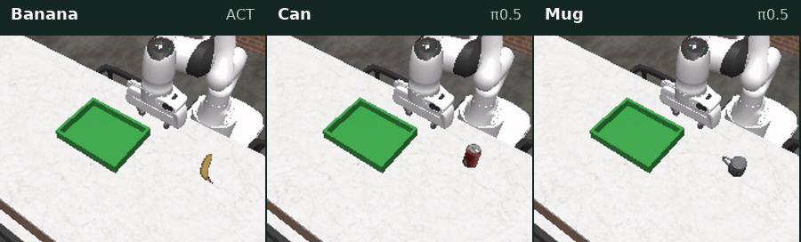

# MaskVLA

**Target-conditioned robot manipulation in simulation.** MaskVLA gives a robot policy an extra camera view that isolates the object it should pick. The ManiSkill workbench pairs a vision-language task agent with a learned grasping policy and lets you rerun the same scene with a different mask. The RoboCasa pilot tests whether ACT and π0.5 can grasp the target, carry it to a tray, release it and leave it there.

[中文说明](docs/README.zh-CN.md) · [VLM agent](docs/vlm-agent.md) · [ManiSkill setup](setup/README.md) · [RoboCasa setup](robocasa_bridge/README.md) · [Evaluation protocol](docs/evaluation.md)



*Left to right, three successful held-out runs in RoboCasa, shown at 2× speed. The policies received a simulator-generated target mask. Open a full-speed recording to see all four views.*

| Policy | Target | Full-speed rollout | Lift |
|---|---|---|---:|
| ACT | Banana | [Watch MP4](docs/media/act-banana.mp4) | 20.6 cm |
| π0.5 | Can | [Watch MP4](docs/media/pi05-can.mp4) | 15.5 cm |
| π0.5 | Mug | [Watch MP4](docs/media/pi05-mug.mp4) | 22.1 cm |

## ManiSkill VLM agent

Give the agent a task in natural language. It inspects the scene, breaks the instruction into pick-and-place steps and locates the requested object in the camera image. SAM 2 and Cutie produce and track the mask. The selected policy (dual-view ACT, triple-view ACT or π0.5) controls grasp and lift. MPLib handles transport and release. The VLM monitors camera frames during execution and checks the final placement.

[Run the agent with your own VLM endpoint](docs/vlm-agent.md) · [Planning and visual prompts](overlays/ManiSkill/examples/baselines/act/task_agent/vlm.py) · [Task execution loop](overlays/ManiSkill/examples/baselines/act/task_agent/runner.py)

The videos above come from the separate RoboCasa evaluation. Across the five archived ManiSkill task-console recordings, the simulator recorded no successful grasp. Three baseball trials (one per policy) recorded zero lift. The other recordings ended during target localization or scene preview.

## What can I run?

| Workbench | What you can do |
|---|---|
| **[ManiSkill](setup/README.md)** | Train or evaluate ACT with base RGB, masked RGB and an optional wrist view. Run a π0.5 policy, compare masks, and restore the same initial scene for another rollout. The perception code integrates SAM 2 and Cutie. |
| **[RoboCasa](robocasa_bridge/README.md)** | Build a kitchen scene, record scripted or manual demonstrations, and inspect state or action replays. The five-object pilot includes collection, training, model workers, closed-loop evaluation and a collision-mesh scorer. |

## Try the CPU checks

Use Python 3.11+ and Git. These tests exercise the RoboCasa action and observation formats, object selection and replay metadata with synthetic fixtures. No GPU, checkpoints or demonstration collection is needed.

```bash
git clone https://github.com/jjjjqqqz101/MaskVLA.git
cd MaskVLA
python3.11 -m venv .venv-bridge
source .venv-bridge/bin/activate
python -m pip install -e ./robocasa_bridge
MASK_POLICY_ROOT="$(mktemp -d)" python -m unittest discover -s robocasa_bridge/tests -v
```

For simulation and training, follow the workbench links above. The repository provides source, changes against pinned upstream revisions, and the three demonstration videos. Supply your own datasets, model checkpoints and simulator assets.

## RoboCasa held-out pick-and-place

On the same ten frozen kitchen scenes, **ACT completed 7/10** and **π0.5 completed 7/10**. Each scene contained one target from five fixed object models. The gripper had to lift the object, place it fully inside the tray, open and retreat while the object stayed still. The camera mask came from the simulator and both policies supplied their own actions throughout the rollout. See the [per-object results, failures and limits](docs/evaluation.md).

## License

Original project code is released under [Apache-2.0](LICENSE). Upstream source, patches and simulator assets retain their respective notices and terms. See the [source licenses](setup/licenses) and the [RoboCasa and robosuite notes](robocasa_bridge/upstream/README.md).
