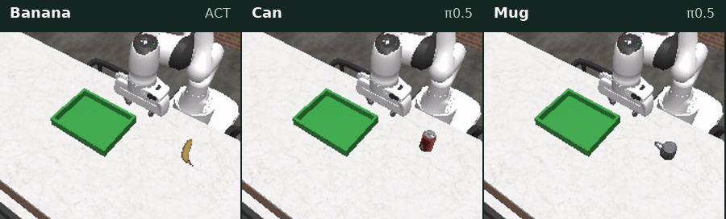

# MaskVLA

MaskVLA 在仿真机械臂的相机输入中加入目标掩码，让策略看到当前应该抓哪个物体。你可以在 ManiSkill 里改变掩码、恢复同一初态并比较策略，也可以在 RoboCasa 的厨房里采集示范、训练 ACT 或 π0.5，并检查机器人能否把目标稳定放入托盘。

上图从左到右分别为 [ACT 抓放香蕉](media/act-banana.mp4)、[π0.5 抓放罐子](media/pi05-can.mp4) 和 [π0.5 抓放马克杯](media/pi05-mug.mp4)。动图以 2 倍速播放，链接指向四视角原速录像。三段都来自自主策略的留出测试。

## 从哪里开始

- **先在 CPU 上验证安装。** [首页的快速检查](../README.md#try-the-cpu-checks) 用合成样本检查观测、动作、物品选择和回放契约。运行这组检查无需下载权重或数据集。
- **试验掩码和策略。** [ManiSkill 安装说明](../setup/README.md) 介绍如何获取固定版本的上游代码、应用本项目的改动，并配置感知和推理环境。
- **采集并评估抓放。** [RoboCasa 工作台](../robocasa_bridge/README.md) 提供采集、标注与回放入口。[五物体实验](../robocasa_bridge/robocasa_pilot/README.md) 提供训练和闭环评估代码。仿真资产、训练数据和检查点需自行准备。

## 演示结果如何解读

五物体实验在同一厨房中选用苹果、香蕉、罐子、肥皂和马克杯，每类预先固定两个测试种子。每次台面上只有一个目标，输入使用仿真器提供的真值掩码，动作由模型自主输出。ACT 和 π0.5 各完成 7/10 次。成功要求双指抓持并抬起物体、完整放入托盘，然后开夹撤离，物体连续稳定至少十个控制步。各物体得分、失败原因和适用范围见[评估说明](evaluation.md)。
